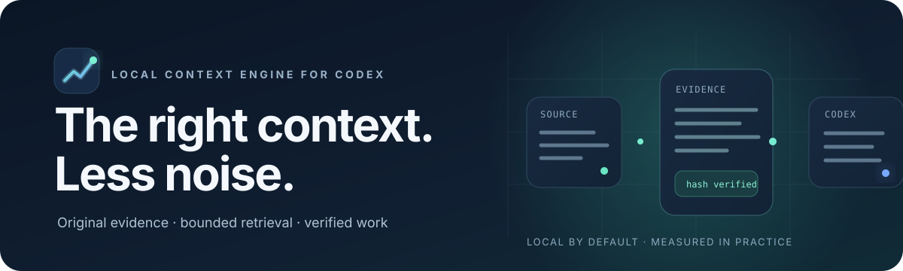
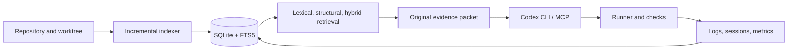

<p align="center">
  
</p>

<p align="center">
  <a href="README.md">Português</a> · <a href="docs/acceptance-report.md">Validation and limits</a> · <a href="evidence/metrics-preview.md">Full metrics</a> · <a href="docs/usage-v2.md">Usage guide</a>
</p>

<p align="center">
  
  
  
  
</p>

<p align="center"><strong>Evidence-backed context. Less noise.</strong><br>
Lume organizes code, retrieves original source spans, and helps Codex run verifiable tasks — keeping ChatGPT sign-in and requiring no OpenAI API key.</p>

## Measured result, not a universal promise

<table align="center">
  <tr>
    <td align="center"><strong>84.16%</strong><br>observed reduction</td>
    <td align="center"><strong>82.83–85.30%</strong><br>95% task-cluster bootstrap interval</td>
    <td align="center"><strong>36 / 36</strong><br>accepted tasks in each arm</td>
    <td align="center"><strong>12 × 3</strong><br>tasks × repetitions per arm</td>
  </tr>
</table>

This result compares baseline Codex (A) with hybrid retrieval and structured edits (E) on 12 synthetic Python, Node, and C++ tasks, repeated three times per arm. Observed usage fell from 3,068,801 to 486,053 tokens across all attempts. The interval is clustered by task; it does not predict savings for every project or task. [Methodology, per-task data, and earlier rounds](docs/benchmark.md).

## Start in a few commands

Requirements: Linux, Python 3.12+, Codex CLI, and an active ChatGPT login.

```bash
git clone https://github.com/L30-R1B/lume.git
cd lume
bash scripts/install.sh
bash scripts/install_skills.sh
```

In the repository you want to work on:

```bash
cd /path/to/your-project
~/.local/bin/ce register my-project "$PWD"  # first time only
~/.local/bin/ce integrate
~/.local/bin/ce setup my-project
~/.local/bin/ce index my-project             # index after setup
codex -p economy
```

Ask Codex to investigate or change the project. The **lume** skill prepares projects when needed; **lume-task** guides evidence retrieval, edits, and verification. Invoke them directly with `$lume` and `$lume-task`.

## An evidence-backed workflow

```bash
# Find a starting point
ce search my-project "exact error or symbol name" --mode hybrid

# Build a context packet from original source under a byte budget
ce context my-project "fix CSV import" --mode hybrid --budget 6000

# Run an isolated task with explicit acceptance and an independent check
ce task my-project \
  "Fix CSV import to preserve UTF-8" \
  "Existing tests pass and encoding is preserved" \
  --verify '["pytest","-q"]'

# Inspect recorded usage and results
ce metrics
```

Context packets carry paths, line ranges, hashes, relations, related tests, and omissions. Returned source is original code; summaries do not replace it. The context budget is measured in bytes and is not a global Codex token cap.

## What Lume includes

- **Local incremental index:** SQLite/FTS5, symbols, provenance-aware relations, snapshots, and updates for uncommitted files.
- **Progressive retrieval:** lexical, structural, and hybrid search; faithful reads; bounded graph and impact queries; targeted refinement.
- **Project adapters:** Python; JavaScript/TypeScript and Node; Kotlin/Gradle; C/C++ with CMake/CTest; Prisma/SQL; Docker/Compose. Missing capabilities are reported explicitly.
- **Local MCP:** six tools for search, read, graph, refresh, handoff, and logs. It uses stdio and opens no network listener.
- **Execution and continuity:** a runner with retrievable output, sessions, handoffs, verification commands, and usage metrics when Codex exposes them.
- **Included skills:** **lume** prepares projects and **lume-task** guides tasks; both include the full CLI/MCP capability catalog.
- **Optional assistance:** Jev and experimental variants are off by default; the main workflow works locally.

## Architecture



The `economy` profile preserves the base Codex config. MCP makes evidence available to the model; it does not intercept every read, command, or internal message.

## Metric transparency

| Record | What it shows | How to read it |
|---|---|---|
| Current confirmation | 84.16%; 95% CI 82.83–85.30%; 36/36 accepted per arm | The 80% target was reached **in this evaluation** |
| Experiment history | 408 attempts, 397 accepted, 23,719,781 observed tokens | Includes exploratory and earlier confirmation rounds; not a savings estimate |
| Historical CLI snapshot | 78 runs, 7 observed Codex turns, 508,278 tokens | Kept separate to avoid possible double counting |
| Real Jev calls | 5 calls, 4,389 input tokens and 751 output tokens | Actual billing and subscription quota are unavailable |

Cached input is a subset of input; reasoning is a subset of output. Failed and earlier attempts remain in the data. A paid Jev comparison was not run. The report also documents Android validation blocked by unavailable KVM/device, missing research PDFs, and large-project limits. See the [acceptance report](docs/acceptance-report.md), [complete metrics preview](evidence/metrics-preview.md), [per-task CSV](evidence/metrics-preview-tasks.csv), and [metrics/artifact JSON](evidence/metrics-preview.json).

## Privacy and limits

Indexing, search, and local execution do not send source code to an auxiliary provider. Jev can receive bounded context only when configured, permitted by project policy, and explicitly enabled. Lume does not extract or redistribute Codex OAuth tokens.

MCP does not alter conversation history or provide observation masking. The local byte budget is not a hard global token limit. The observed Codex CLI does not expose a supported subscription-usage counter; Lume does not estimate quota or guarantee 80% on individual tasks. See [privacy, operations, and technical limits](docs/operations.md).

## Documentation

- [Usage, configuration, and skill installation](docs/usage-v2.md)
- [Architecture and 0.2 release notes](docs/release-0.2.md)
- [Requirements matrix](docs/requirements.md)
- [Research traceability](docs/research.md)
- [Validation and outstanding items](docs/acceptance-report.md)
- [Benchmark methodology and results](docs/benchmark.md)
- [Implementation checkpoint](docs/checkpoint.md)

## License

Lume is released under the [MIT License](LICENSE). Third-party dependencies retain their own licenses.
