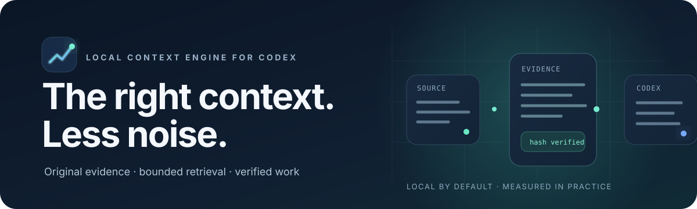
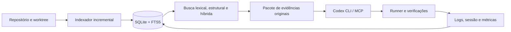

<p align="center">
  
</p>

<p align="center">
  <a href="README.en.md">English</a> · <a href="docs/acceptance-report.md">Validação e limites</a> · <a href="evidence/metrics-preview.md">Métricas completas</a> · <a href="docs/usage-v2.md">Guia de uso</a>
</p>

<p align="center">
  
  
  
  
</p>

<p align="center"><strong>Contexto com evidência. Trabalho com menos ruído.</strong><br>
Lume organiza código, recupera trechos originais e ajuda o Codex a executar tarefas verificáveis — mantendo o login do ChatGPT e sem exigir chave da API da OpenAI.</p>

## Resultado medido, sem promessa universal

<table align="center">
  <tr>
    <td align="center"><strong>84,16%</strong><br>redução observada</td>
    <td align="center"><strong>82,83–85,30%</strong><br>intervalo bootstrap de 95%</td>
    <td align="center"><strong>36 / 36</strong><br>tarefas aceitas em cada braço</td>
    <td align="center"><strong>12 × 3</strong><br>tarefas e repetições por braço</td>
  </tr>
</table>

Esse resultado compara Codex de referência (A) com recuperação híbrida e edição estruturada (E), em 12 tarefas sintéticas de Python, Node e C++, com três repetições por braço. A redução medida foi de 3.068.801 para 486.053 tokens observados, somando todas as tentativas. O intervalo é agrupado por tarefa e não indica o resultado esperado em qualquer projeto ou tarefa. [Método, dados por tarefa e rodadas anteriores](docs/benchmark.md).

## Comece em poucos comandos

Requisitos: Linux, Python 3.12+, Codex CLI instalado e login ChatGPT ativo.

```bash
git clone https://github.com/L30-R1B/lume.git
cd lume
bash scripts/install.sh
bash scripts/install_skills.sh
```

No repositório em que vai trabalhar:

```bash
cd /caminho/do/seu-projeto
~/.local/bin/ce register meu-projeto "$PWD"  # primeira vez
~/.local/bin/ce integrate
~/.local/bin/ce setup meu-projeto
~/.local/bin/ce index meu-projeto            # indexe depois do setup
codex -p economy
```

Agora peça ao Codex para investigar ou alterar o projeto. A skill **lume** prepara o projeto quando necessário; **lume-task** guia a busca de evidências, edição e verificação. As skills também podem ser chamadas explicitamente com `$lume` e `$lume-task`.

## Um fluxo de trabalho com evidências

```bash
# Ache o ponto de partida
ce search meu-projeto "erro exato ou nome do símbolo" --mode hybrid

# Monte contexto de código original sob um orçamento em bytes
ce context meu-projeto "corrigir importação CSV" --mode hybrid --budget 6000

# Execute uma tarefa isolada com critérios e verificação independente
ce task meu-projeto \
  "Corrija a importação de CSV para preservar UTF-8" \
  "Os testes existentes passam e a codificação é preservada" \
  --verify '["pytest","-q"]'

# Veja uso observado e resultados armazenados
ce metrics
```

O contexto contém caminhos, linhas, hashes, relações, testes relacionados e omissões. A fonte devolvida é original; resumos não substituem o código. O limite de contexto é em bytes e não impõe um teto global de tokens ao Codex.

## O que vem no Lume

- **Índice local e incremental:** SQLite/FTS5, símbolos, relações com proveniência, snapshots e atualização para arquivos não commitados.
- **Recuperação progressiva:** busca lexical, estrutural e híbrida, leitura fiel, grafo limitado, impacto e refinamento direcionado.
- **Adaptadores por projeto:** Python; JavaScript/TypeScript e Node; Kotlin/Gradle; C/C++ com CMake/CTest; Prisma/SQL; Docker/Compose. Capacidades ausentes aparecem explicitamente.
- **MCP local:** seis ferramentas para busca, leitura, grafo, atualização, handoff e logs. O transporte é stdio; não abre um servidor de rede.
- **Execução e continuidade:** runner com saída recuperável, sessões, handoffs, comandos de verificação e métricas de uso quando o Codex as expõe.
- **Skills incluídas:** `lume` para preparar projetos e `lume-task` para conduzir tarefas, ambas com catálogo das capacidades CLI/MCP.
- **Assistência opcional:** Jev e variantes experimentais ficam desligados por padrão; o caminho principal funciona localmente.

## Arquitetura



O perfil `economy` preserva a configuração base do Codex. O MCP torna evidências disponíveis ao modelo, mas não intercepta automaticamente todas as leituras, comandos ou mensagens internas.

## Transparência das métricas

| Registro | O que mostra | Como interpretar |
|---|---|---|
| Confirmação atual | 84,16%; IC 95% 82,83–85,30%; 36/36 aceites por braço | Meta de 80% atingida **nesta avaliação** |
| Histórico de experimentos | 408 tentativas, 397 aceitas, 23.719.781 tokens observados | Junta rodadas exploratórias e confirmações; não é uma estimativa de economia |
| Snapshot histórico do CLI | 78 execuções, 7 turnos Codex, 508.278 tokens | Separado dos experimentos para evitar possível dupla contagem |
| Jev real | 5 chamadas, 4.389 tokens de entrada e 751 de saída | Custo efetivamente cobrado e limite da assinatura indisponíveis |

Cache é subconjunto da entrada; raciocínio é subconjunto da saída. Falhas e tentativas anteriores permanecem nos dados. A comparação paga com Jev não foi executada. O relatório também documenta a validação Android bloqueada por falta de KVM/dispositivo, os PDFs de pesquisa indisponíveis e limites de escala. Consulte [o relatório de aceitação](docs/acceptance-report.md), [a prévia completa](evidence/metrics-preview.md), [o CSV por tarefa](evidence/metrics-preview-tasks.csv) e [o JSON de métricas e artefatos](evidence/metrics-preview.json).

## Privacidade e limites

Indexação, busca híbrida e execução local não enviam código a um provedor auxiliar. Jev só pode receber contexto limitado quando está configurado, permitido pela política do projeto e explicitamente habilitado. Não há leitura ou redistribuição de tokens OAuth do Codex.

MCP não altera o histórico nem aplica masking. O contador de uso da assinatura não é exposto pelo Codex CLI observado; Lume não estima quota nem garante 80% em tarefas individuais. [Privacidade, operação e limites técnicos](docs/operations.md).

## Documentação

- [Uso, configuração e instalação de skills](docs/usage-v2.md)
- [Arquitetura e revisão 0.2](docs/release-0.2.md)
- [Matriz de requisitos](docs/requirements.md)
- [Rastreabilidade das pesquisas](docs/research.md)
- [Validação e pendências](docs/acceptance-report.md)
- [Metodologia e resultados dos benchmarks](docs/benchmark.md)
- [Checkpoint da implementação](docs/checkpoint.md)

## Licença

Lume é distribuído sob a licença [MIT](LICENSE). Dependências de terceiros mantêm suas próprias licenças.
